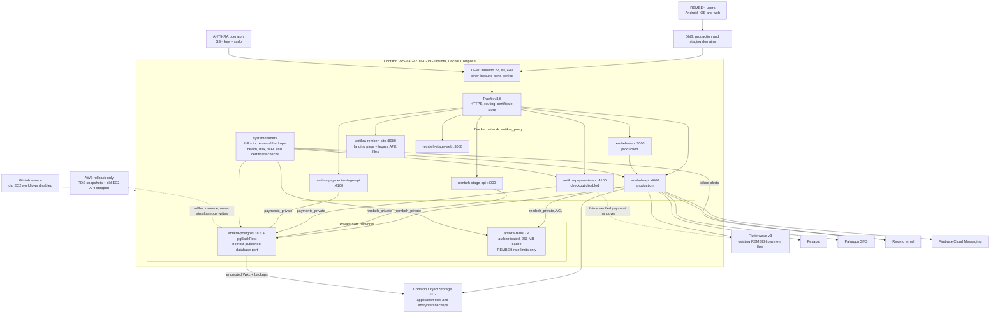
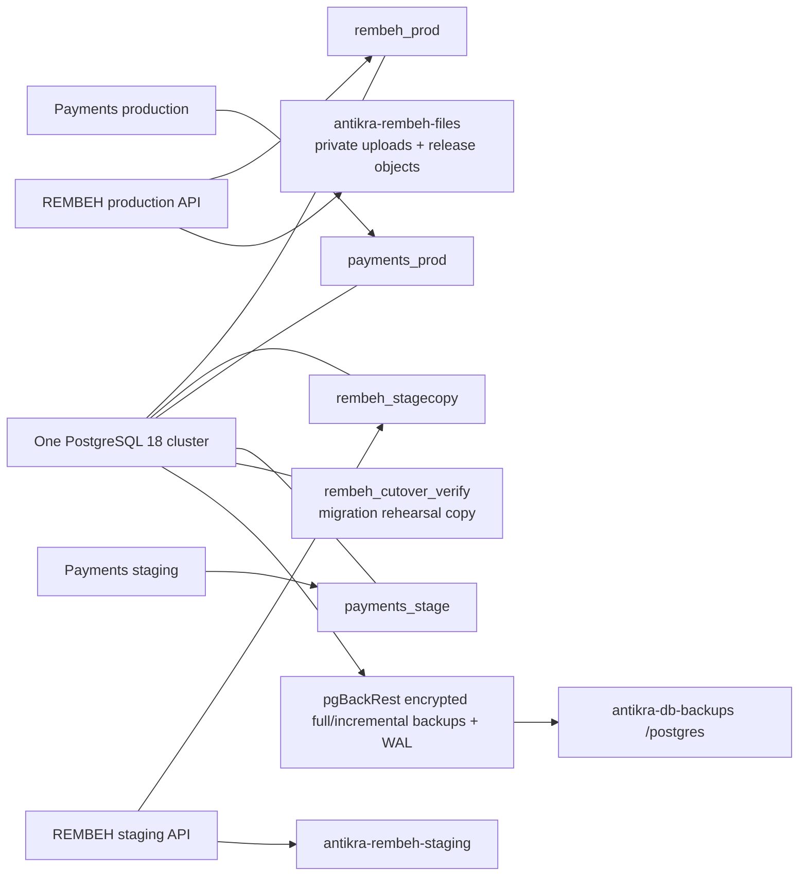
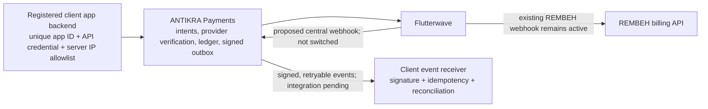

# ANTIKRA Production Infrastructure

Verified on 29 October 2026. This document distinguishes running infrastructure from planned capabilities; it is not a claim that every payment workflow is production-ready.

## Overall Architecture

## Domains And Services

| Domain | Route | Current purpose |
| --- | --- | --- |
| `rembeh.antikra.com` | Traefik to `rembeh-web:3000` | Production web app |
| `rembeh-api.antikra.com` | Traefik to `rembeh-api:4000` | Production API and existing Flutterwave/Pesapal callbacks |
| `get.rembeh.antikra.com` | Traefik to static site `:8080` | Landing page and previously published direct APK links |
| `staging.antikra.com` | Traefik to staging web | Protected by HTTP Basic authentication |
| `staging-api.antikra.com` | Traefik to staging API | Application authentication; separate staging database |
| `staging-site.antikra.com` | Traefik to static site | Landing-site preview |
| `payments.antikra.com` | Traefik to Payments `:4100` | Independent service; live checkout remains disabled |

Traefik uses the file provider under `/srv/antikra/infrastructure/proxy/traefik/dynamic`. Only Traefik publishes ports 80 and 443. PostgreSQL, Redis and application ports are not published to the host. SSH on port 22 is reachable publicly and should be restricted further where operationally possible. UFW and Docker networking must both be considered when reviewing exposure.

## Databases And Storage

Production and staging are separate databases and application roles but share the same PostgreSQL container and host. Both REMBEH environments share `rembeh_private`; both Payments environments share `payments_private`. This is logical isolation, not a separate host or high-availability cluster. The VPS and its object store are both Contabo dependencies. An independent-provider or off-region backup is still needed for provider-wide disaster recovery.

`rembeh_app` has runtime permissions; migrations use `rembeh_migrator`. Payments uses its own roles. Secrets are kept under service-specific `secrets/` directories and are not committed. The pgBackRest encryption credentials also need a secure, recoverable copy outside the VPS. Do not paste passwords, API keys or signed URLs into tickets or logs.

The final AWS export was frozen and verified before restore. Counts and financial control totals matched, and 5,601 object keys, sizes and MD5 hashes matched. RDS snapshot `rembeh-final-cutover-20261029` and the frozen AWS API provide rollback evidence, not a second live primary. Rollback after new VPS writes requires a new freeze and an explicit reverse-data migration or accepted data-loss decision.

## Protection And Operations

| Capability | Current state |
| --- | --- |
| PostgreSQL | `antikra/postgres-pgbackrest:18-2.60.0`; authenticated connections |
| Backup | Encrypted pgBackRest repository in `antikra-db-backups`; daily full, hourly incremental; seven full backups retained |
| Recovery | WAL archiving enabled; isolated named-point-in-time restore rehearsal passed on 29 October 2026 |
| Monitoring | systemd checks PostgreSQL, archive errors, recent backups, disk usage, production containers, API health, Redis and certificate expiry; email to `admin@antikra.com` |
| Redis | Private to `rembeh_private`, ACL-limited to rate-limit keys/commands, AOF persistence; no financial records stored there |
| TLS | Existing production certificates were copied securely and currently work. Automated renewal for those imported certificates is not yet verified; they expire on 25 November 2026. |
| Deployment | Images run from reviewed tags; old AWS GitHub deployment workflows are disabled. The new operator script checks image availability, backup health and the expected current tag. Full automated CI/CD is not yet configured. |
| Logs and resilience | Container logs and host services exist; centralized log retention, provider-independent disaster recovery, HA, comprehensive metrics and payment-specific operational alerts remain to be implemented. |

Redis currently emits a host memory-overcommit advisory; no global kernel setting was changed without assessing its effect on PostgreSQL and the other services.

## Payment Boundaries

The Payments process is reachable and has a separate database, but checkout is disabled and REMBEH is not yet onboarded as a verified client. Do not switch the Flutterwave dashboard webhook until existing REMBEH transactions are routed safely, signed events are durably consumed, replay/idempotency and provider verification are tested, and settlement/reconciliation procedures are operational. Existing provider callbacks must continue to work during any transition. Future applications receive separate identities only when registered; do not invent identities for applications that do not yet exist.

## Important Paths

| Path | Contents |
| --- | --- |
| `/srv/antikra/infrastructure/proxy/traefik/` | Proxy configuration, routes and certificate store |
| `/srv/antikra/infrastructure/postgres/` | PostgreSQL Compose, data, backup configuration and protected credentials |
| `/srv/antikra/infrastructure/redis/` | Redis Compose, ACL credentials and persistent rate-limit data |
| `/srv/antikra/infrastructure/backups/imports/` | Protected migration dumps, manifests and control totals |
| `/srv/antikra/services/rembeh/` | Production/staging Compose files, release selector and protected secrets |
| `/srv/antikra/services/payments/` | Independent Payments service and environment-specific secrets |
| `/srv/antikra/services/web-hosting/sites/rembeh/` | Static landing site and legacy APK files |

Operator deployment and release procedures are in [scripts/README.md](../../scripts/README.md). The masterplan describes the intended architecture; this file records the observed deployment and its outstanding gaps.
